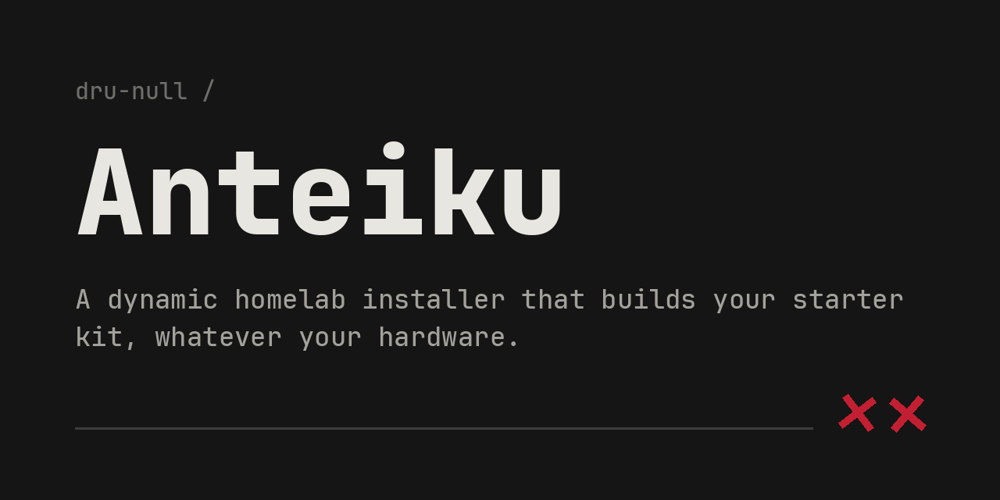
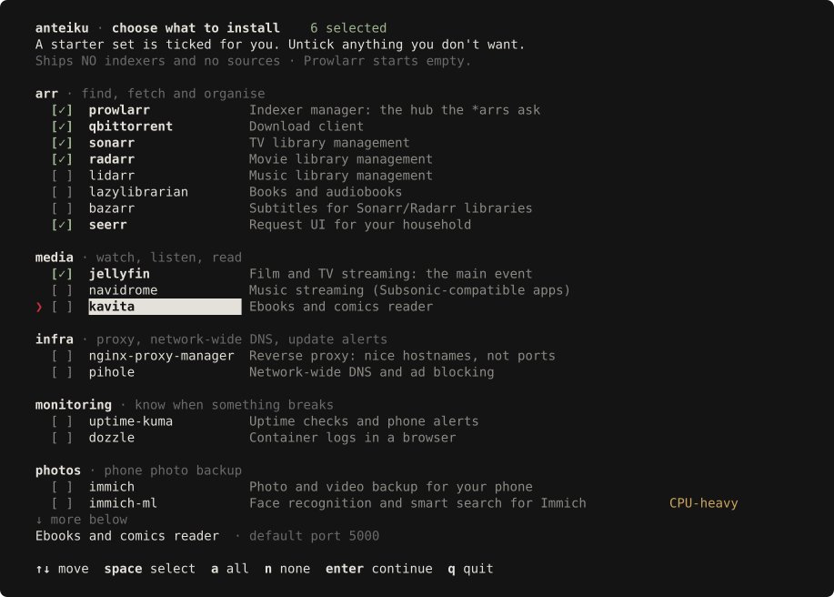

[](assets/anteiku-preview.png)

# Anteiku

A dynamic homelab installer that builds your starter kit, whatever your hardware.

[](https://github.com/Dru-null/Anteiku/actions/workflows/check.yml)

Named after a café where anyone could find a seat and a place to start.

> [!IMPORTANT]
> **No indexers, no trackers, no sources.** Anteiku installs the software and
> nothing to put in it. Prowlarr starts empty and stays that way until you set
> it up yourself. What goes in is your call and your responsibility.
> Rip the discs you own, buy DRM-free, use the public domain.

## What it does

- **Reads your machine first.** `doctor.sh` surveys CPU, RAM, GPU, ports and disks, and writes nothing.
- **Lets you pick.** 21 services in a full-screen list, a small starter set ticked. Taken ports shift to the next free one; `ports.md` records what each service got.
- **Fits the hardware.** An Intel, NVIDIA or AMD GPU is wired into Jellyfin for transcoding; without one, it runs on the CPU.
- **Re-runs safely.** Installed services are locked, so a re-run only adds. Passwords, ports and paths stay as they were.
- **Watches and backs up.** Uptime monitors are generated from what you installed. Backups cover configs, secrets and databases.

Nothing starts by itself. `setup.sh` writes the config and stops; you read it, then run compose.



## Start with a machine

An old laptop, a mini-PC or a spare desktop. 4 GiB of RAM works, 8 is comfortable.
If it already runs Linux with Docker, skip to [Running it yourself](#running-it-yourself).

<details>
<summary>Installing Ubuntu Server, step by step</summary>

1. Download **Ubuntu Server 26.04 LTS** from [ubuntu.com/download/server](https://ubuntu.com/download/server).
2. Write it to a USB stick of 4 GB or more with [balenaEtcher](https://etcher.balena.io/) (or Rufus on Windows). The stick is erased.
3. Plug it in and power on. Open the boot menu with the key your machine's maker uses, usually Esc, F2, F10 or F12, and pick the USB stick.
4. In the installer:
   - **Language, keyboard:** yours.
   - **Network:** leave it on DHCP.
   - **Storage:** "Use an entire disk" erases that disk. Choose it only if nothing on it matters. Leave a second disk for media alone; mount it later.
   - **Profile:** your name, a server name, a username and a password.
   - **SSH configuration:** tick **Install OpenSSH server**. It is off by default, and it's how you'll reach the machine from another computer.
   - **Featured server snaps:** tick nothing. Docker comes next, from Docker itself.
5. Remove the stick when asked, reboot, log in. Then update:
   ```bash
   sudo apt update && sudo apt full-upgrade
   ```
6. Install Docker Engine and the Compose plugin from [Docker's apt repository](https://docs.docker.com/engine/install/ubuntu/). Not the `docker` snap, which only sees your home folder, and not Ubuntu's `docker.io`.
7. Let your user run Docker, then log out and back in:
   ```bash
   sudo usermod -aG docker $USER
   ```
   Membership of the `docker` group is [root-level access](https://docs.docker.com/engine/install/linux-postinstall/). Keep it to your own user.
8. Give the machine a fixed address: in your router, add a DHCP reservation for it. `hostname -I` shows its current one.

</details>

## Running it yourself

1. Clone it:
   ```bash
   git clone https://github.com/dru-null/Anteiku.git anteiku && cd anteiku
   ```
2. See what you have. Read-only, and safe to paste into an issue:
   ```bash
   ./doctor.sh
   ```
3. Pick your services and write the config. `--dry-run` shows every decision and writes nothing:
   ```bash
   ./setup.sh
   ```
   `↑` `↓` to move, `space` to tick, `a` / `n` for all or none, `enter` to continue, `q` to quit.
4. Start them:
   ```bash
   docker compose up -d
   ```
5. Open `ports.md` for the address of each service.
6. Follow the guide for each stack in `stacks/`: [arr](stacks/arr.md), [media](stacks/media.md), [infra](stacks/infra.md), [monitoring](stacks/monitoring.md), [photos](stacks/photos.md), [extras](stacks/extras.md), [books](stacks/books.md). Each has a setup order and a Traps section.

To add services later, run `./setup.sh` again. `--reconfigure` changes what's already installed, after asking.

## When you're stuck

Everything here has a guide. Read the one for what you're doing before changing anything:

| Guide | Covers |
|---|---|
| [`stacks/*.md`](stacks/) | each service: what it's for, setup order, and the traps that catch people |
| [`docs/remote-access.md`](docs/remote-access.md) | reaching your services from outside, safely |
| [`docs/backups.md`](docs/backups.md) | what's backed up, scheduling, testing a restore |
| [`docs/updating.md`](docs/updating.md) | moving a service to a new version, and back |

If a guide doesn't make sense, ask. An AI assistant is good at explaining a term, an error or a log line; paste the error and the part of the guide you're on. `doctor.sh` and `setup.sh` output is safe to share. Never paste your `.env`: it holds your passwords.

Still stuck, or found something wrong: [open an issue](https://github.com/dru-null/Anteiku/issues) with your `doctor.sh` output.

## Notes

- **Never forward ports** on your router. Remote access goes through a mesh VPN.
- **Back up before** you put anything you care about on here. `scripts/backup.sh` covers configs, secrets and databases, not media or your photo files.
- **Nothing updates by itself.** Every image is pinned to the version that was tested; [`CHANGELOG.md`](CHANGELOG.md) says what each release changed.
- **One filesystem:** downloads and library share one `MEDIA_ROOT`, so imports are hardlinks, not copies. Split them and the disk fills twice as fast.
- **Tested:** every service together on x86_64, Ubuntu 26.04, Intel iGPU. NVIDIA, AMD, ARM64 and rootless Docker are written from upstream docs and not yet tested; the scripts say so when you're on one of those paths.

## Contributing

See [`CONTRIBUTING.md`](CONTRIBUTING.md). Run `./scripts/check.sh` before every commit.

## Built with

Bash, Docker Compose, and the images of the projects listed in each stack guide.

## License

MIT. See [`LICENSE`](LICENSE).

<p align="right">
<picture>
  <source media="(prefers-color-scheme: dark)" srcset="https://raw.githubusercontent.com/dru-null/dru-null/main/assets/sig-dark.svg">
  <source media="(prefers-color-scheme: light)" srcset="https://raw.githubusercontent.com/dru-null/dru-null/main/assets/sig-light.svg">
  
</picture>
</p>
